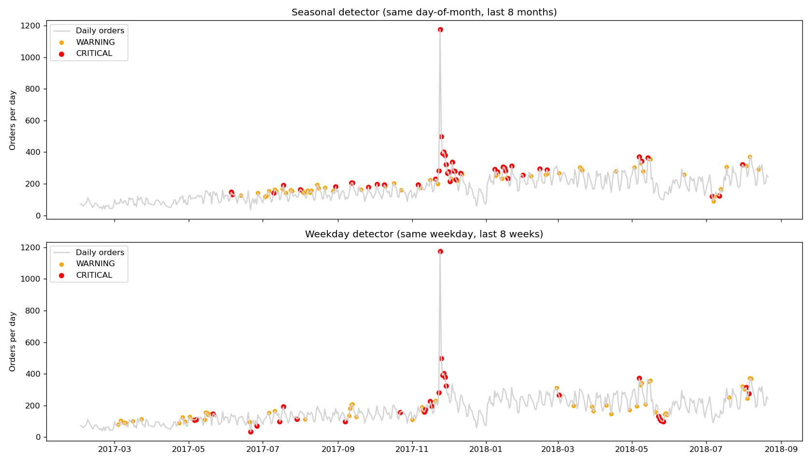

# 🔍 Transaction Volume Anomaly Detector (SQL + Python)

A z-score anomaly detector for **daily transaction volume**, written in SQL and tested on **~99,000 real e-commerce orders** from Olist, a Brazilian online marketplace.

It's a public rebuild of an approach I developed during my data analytics internship at a payments company. The original code and data are confidential, so this version is built from scratch on public data.

## How it works

For each day, the detector:
1. Finds comparable past days: the **same weekday over the previous 8 weeks**.
2. Calculates their mean and standard deviation.
3. Computes a **z-score**: how many standard deviations today is from normal.
4. Flags **WARNING** at |z| ≥ 2 and **CRITICAL** at |z| ≥ 3.

All of it runs in SQL using window functions (`PARTITION BY`, `ROWS BETWEEN 8 PRECEDING AND 1 PRECEDING`), run through **DuckDB** directly on a pandas DataFrame.

## Two baselines compared

My internship version compared each day with the **same day-of-month** in previous months. That works for payments, where paydays drive volume. Applied to this e-commerce data, it raised far too many alerts:

| | Day-of-month (last 8 months) | Weekday (last 8 weeks) |
|---|---|---|
| CRITICAL | 44 | 29 |
| WARNING | 57 | 54 |
| Share of scored days flagged | ~23% | ~15% |

**Why the first one struggled:**
- **Growth:** order volume roughly doubled during 2017, so comparing with 8 months earlier made normal days look like spikes.
- **Wrong cycle:** online shopping follows the **day of the week** (about 197 orders on Mondays vs 132 on Saturdays), not paydays.

## Real events the detector caught

| Date | What happened | Orders vs normal |
|---|---|---|
| 24–29 Nov 2017 | **Black Friday** week | 1,176 on the 24th vs ~146 normal |
| 7 Sep 2017 | **Independence Day** (public holiday) | 99 vs ~143 |
| 23–27 May 2018 | **Nationwide truckers' strike** | ~100–130 vs ~260 |

## Limitations & next steps

- **Big anomalies distort the baseline.** Black Friday stays in the 8-week history afterwards, inflating the standard deviation and hiding smaller anomalies. A median/MAD baseline, or excluding already-flagged days, would fix this.
- **Known holidays** could be added to a calendar table, so expected events aren't flagged.
- **No ground-truth labels:** with real data, alerts are checked against known events instead of an accuracy score.

## Files

| File | Description |
|---|---|
| `anomaly_detection.ipynb` | Full analysis: loading, both detectors, comparison |
| `sql/seasonal_detector.sql` | Day-of-month baseline (internship-style) |
| `sql/weekday_detector.sql` | Weekday baseline (final version) |
| `images/` | Charts |

## Run it yourself

1. Download `olist_orders_dataset.csv` from [Brazilian E-Commerce Public Dataset by Olist](https://www.kaggle.com/datasets/olistbr/brazilian-ecommerce) on Kaggle and put it in a `data/` folder.
2. `pip install duckdb pandas numpy matplotlib jupyter`
3. Run `anomaly_detection.ipynb`.

---
*Lovella Dian Fernando · [LinkedIn](https://linkedin.com/in/lovellafernando)*